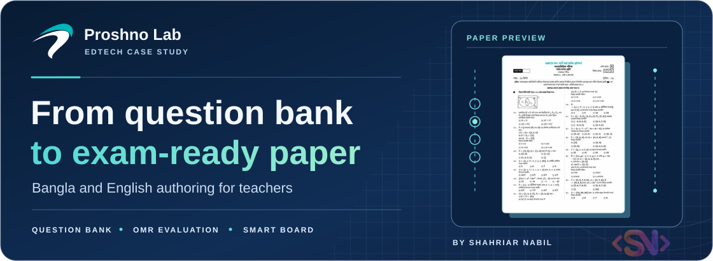
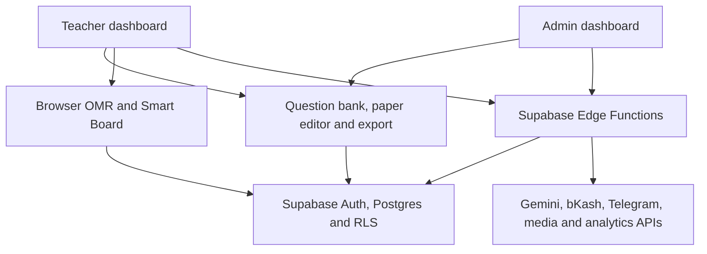

<h1 align="center">
  <a href="https://proshnolab.com/"></a>
</h1>

<p align="center">
  <strong>Question paper authoring, OMR evaluation, and classroom presentation for teachers in Bangladesh.</strong>
</p>

<p align="center">শিক্ষকদের জন্য বাংলা ও ইংরেজি ভার্সনে প্রশ্নপত্র তৈরির প্ল্যাটফর্ম।</p>

<p align="center">
  <a href="https://proshnolab.com/"><strong>Visit Proshno Lab</strong></a> ·
  <a href="https://www.proshnolab.com/demo">Question bank demo</a> ·
  <a href="#paper-authoring">Paper authoring</a> ·
  <a href="#omr-and-smart-board">OMR and Smart Board</a> ·
  <a href="#local-development">Local development</a>
</p>

## Overview

Proshno Lab helps teachers assemble exams from a curriculum question bank and prepare them for print or classroom use. Teachers can select questions manually, generate a paper from a chapter and question mix, or assemble an English First Paper from its own exam pattern. The platform also covers answer keys, OMR sheets and evaluation, and a Smart Board for teaching from saved papers.

| Area | What it covers |
| --- | --- |
| **Question bank** | Class, subject, chapter, version, question type, topic, and exam references |
| **Exam authoring** | Manual and automatic selection, answer keys, layout controls, print and PDF, and editable DOCX |
| **Classroom tools** | Browser-based OMR scanning and an interactive whiteboard with question and answer slides |
| **Platform operations** | Content ingestion and moderation, teacher and institute administration, subscriptions, and payment and marketing workflows |

The cover pairs the current [Proshno Lab symbol](./src/assets/brand-symbol-dark.svg) with the [real mathematics paper](./src/assets/hero-real-question.webp) used on the landing page. Its animation respects reduced-motion preferences.

## Paper authoring

| Stage | Capabilities and source |
| --- | --- |
| **Choose the syllabus** | Pick a class, subject, Bangla or English version where available, and chapters. Explore chapter, board, and topic filters. [Question demo](./src/pages/DemoPage.tsx) · [Manual picker](./src/pages/dashboard/QuestionCreate.tsx) · [Version rules](./src/lib/subjectVersion.ts) |
| **Assemble questions** | Pick questions manually or let the automatic builder select a distinct set using counts for MCQ, creative (CQ), short, and descriptive questions. The English First Paper builder supports patterns, passages, and grouped language exercises. [Create hub](./src/pages/dashboard/QuestionCreateHub.tsx) · [Auto builder](./src/pages/dashboard/AutoQuestionCreate.tsx) · [English First Paper](./src/components/dashboard/EnglishFirstPaperBuilder.tsx) |
| **Format the exam** | Edit questions in the paper, set institute and exam details, adjust fonts and columns, choose A4, A5, Letter, or Legal, shuffle set codes, and include answer sheets or OMR bubbles. Tiptap handles rich text, and KaTeX renders math. [Paper editor](./src/pages/dashboard/QuestionPaperView.tsx) · [Rich text](./src/components/RichTextEditor.tsx) · [Answer sheet](./src/components/paper/ChirkutAnswerSheet.tsx) |
| **Save and export** | Save and reopen papers in the teacher dashboard. Use print-ready pagination for printing or PDF and export editable Word files with math conversion. [Saved papers](./src/pages/dashboard/MyQuestions.tsx) · [Print layout](./src/components/paper/PrintableDocument.tsx) · [DOCX export](./src/lib/docxExport.ts) |

## OMR and Smart Board

| Tool | How it works |
| --- | --- |
| **OMR sheet design** | Configure and print a standalone answer sheet, or include an OMR box in a question paper. Create evaluation tokens with answer keys and marking settings. [Sheet builder](./src/pages/dashboard/omr/OmrCreate.tsx) · [Token manager](./src/pages/dashboard/omr/OmrTokens.tsx) |
| **OMR evaluation** | Import sheet photos or use a camera input. OpenCV.js processes images in the browser. The app can save evaluation results and export CSV. [Evaluation screen](./src/pages/dashboard/omr/OmrEvaluation.tsx) · [OpenCV pipeline](./src/lib/omrVision.ts) · [OMR data](./src/lib/omrEngine.ts) |
| **Interactive Smart Board** | Load a saved paper, present question and answer slides, annotate a blank board or slides, use shapes and a scientific calculator, and print or save the presentation as PDF. [Smart Board](./src/pages/dashboard/SmartBoard.tsx) · [Canvas](./src/components/smartboard/BoardCanvas.tsx) · [Slide export](./src/lib/printSmartboard.ts) |

## Platform operations

| Area | Capabilities and source |
| --- | --- |
| **Accounts and institutes** | Supabase email/password and Google sign-in, registration and recovery, teacher profiles, institute details, feedback, and announcements. [Auth context](./src/contexts/AuthContext.tsx) · [Email login](./src/pages/EmailLogin.tsx) · [Institute](./src/pages/dashboard/Institute.tsx) |
| **Curriculum and question moderation** | Manage classes, subjects, chapters, topics, question references, explanations, reported questions, and duplicates. [Question admin](./src/pages/admin/AdminQuestions.tsx) · [Chapter admin](./src/pages/admin/AdminChapters.tsx) · [Duplicate review](./src/pages/admin/AdminQuestionDuplicates.tsx) · [Reports](./src/pages/admin/AdminQuestionReports.tsx) |
| **Bulk import** | Import spreadsheets, paste questions, enter multiple items, or extract structured questions from text, images, and PDFs with Gemini. Review parsed rows, route them to chapters, and check duplicates before saving. [Bulk import](./src/pages/admin/AdminQuestionsBulk.tsx) · [AI import UI](./src/components/admin/bulk/AIExtract.tsx) · [Extraction function](./supabase/functions/extract-bulk-questions/index.ts) |
| **Pricing and access** | Ready-made packages, custom subject and version bundles, coupons, subscription access, and pay-per-paper generation. [Pricing](./src/pages/PricingPage.tsx) · [Custom packages](./src/components/CustomPackageBuilder.tsx) · [Access matching](./src/lib/subscriptionMatcher.ts) · [Pay-per-paper](./supabase/functions/payg-paper/index.ts) |
| **Checkout and support** | bKash checkout, verified payment callbacks, entitlement activation and reconciliation, subscription SMS, and queued Telegram payment notices. [Checkout](./src/pages/CheckoutPage.tsx) · [Payment callback](./src/pages/PaymentCallback.tsx) · [Reconciliation](./supabase/functions/payment-access-reconcile/index.ts) · [Subscriptions](./src/pages/admin/AdminSubscriptions.tsx) |
| **Permissions and analytics** | Admin page and subject permissions, owner-gated financial views, marketing metrics, and a retryable server-side conversion outbox. [Admin gate](./src/components/admin/AdminLayout.tsx) · [Subject permissions](./src/hooks/useAdminPermissions.ts) · [Marketing overview](./src/components/admin/MarketingOverview.tsx) · [SQL migrations](./supabase/migrations) |

## Architecture



The [React route tree](./src/App.tsx) serves public pages, teacher tools, and admin screens. [Vercel](./vercel.json) rewrites SPA routes to the entry point. The [typed Supabase client](./src/integrations/supabase/client.ts), [84 SQL migrations](./supabase/migrations), and [14 Edge Functions](./supabase/functions) implement authentication, content access, teacher data, commerce, and provider integrations.

## Integrations

| Integration | Role |
| --- | --- |
| **Gemini API** | Extracts questions from text, images, and PDFs for authenticated admins. The default is `gemini-3.5-flash-lite`. [Extraction function](./supabase/functions/extract-bulk-questions/index.ts) · [Model documentation](https://ai.google.dev/gemini-api/docs/models/gemini-3.5-flash-lite) |
| **bKash** | Creates, executes, and verifies payments for packages and individual papers. [Create](./supabase/functions/bkash-create-payment/index.ts) · [Execute](./supabase/functions/bkash-execute-payment/index.ts) · [Query](./supabase/functions/bkash-query-payment/index.ts) |
| **Telegram Bot API** | Delivers verified payment outcomes and operations notices. The worker records delivery per recipient and retries failed sends. [Worker](./supabase/functions/payment-telegram-worker/index.ts) · [Notification function](./supabase/functions/notify-telegram/index.ts) |
| **BulkSMSBD and BulkSMSDhaka** | Sends subscription-related messages from owner-authorized admin workflows. [SMS function](./supabase/functions/admin-subscription-sms/index.ts) |
| **Cloudinary** | Supplies media upload configuration for rich-text images and hosts selected brand assets. [Media function](./supabase/functions/cloudinary-config/index.ts) · [Brand assets](./src/lib/brandAssets.ts) |
| **Google Tag Manager, Meta Pixel, and Meta Conversions API** | Browser tracking and server-side conversion delivery, with event deduplication and retry handling. [Tracking entry point](./src/lib/analytics.ts) · [Pixel setup](./META_PIXEL_SETUP.md) · [Conversions API setup](./META_CAPI_SETUP.md) |

<details>
<summary><strong>All 14 Edge Functions by workflow</strong></summary>

| Workflow | Functions |
| --- | --- |
| Content and media | `extract-bulk-questions`, `export-docx`, `cloudinary-config` |
| Payments and access | `bkash-create-payment`, `bkash-execute-payment`, `bkash-query-payment`, `payg-paper`, `payment-access-reconcile` |
| Notifications | `notify-telegram`, `payment-telegram-worker`, `daily-summary`, `admin-subscription-sms` |
| Analytics | `track-event`, `meta-capi-worker` |

[Function source directory](./supabase/functions)

</details>

## Stack and versions

The versions below are resolved from the checked-in [npm lockfile](./package-lock.json). The [Bun lockfile](./bun.lock) supports frozen installation as well.

| Layer | Packages | Locked versions |
| --- | --- | --- |
| Application | React and React DOM, React Router DOM, TanStack React Query | `18.3.1`, `6.30.1`, `5.83.0` |
| Build and styling | Vite, React SWC, TypeScript, Tailwind CSS, shadcn/ui | `5.4.19`, `3.11.0`, `5.8.3`, `3.4.17`, local UI components |
| Editor and math | Tiptap, KaTeX, MathML to OMML | `3.20.0`, `0.16.33`, `0.5.0` |
| Documents and spreadsheets | DOCX, SheetJS | `9.7.1`, `0.18.5` |
| OMR and charts | OpenCV.js, Recharts | `5.0.0-release.1`, `2.15.4` |
| Backend | Supabase JS, Postgres, Supabase Edge Functions | `2.116.0` for the app SDK, managed Postgres and Deno |
| Tests and checks | Vitest, PGlite, Deno, ESLint | `3.2.4`, `0.5.9`, `2.9.6` in CI, `9.32.0` |

<details>
<summary><strong>All 95 direct dependencies and their locked versions</strong></summary>

| Package | Version | Scope |
| --- | --- | --- |
| `@electric-sql/pglite` | `0.5.9` | Tooling |
| `@eslint/js` | `9.32.0` | Tooling |
| `@hookform/resolvers` | `3.10.0` | Application |
| `@radix-ui/react-accordion` | `1.2.11` | Application |
| `@radix-ui/react-alert-dialog` | `1.1.14` | Application |
| `@radix-ui/react-aspect-ratio` | `1.1.7` | Application |
| `@radix-ui/react-avatar` | `1.1.10` | Application |
| `@radix-ui/react-checkbox` | `1.3.2` | Application |
| `@radix-ui/react-collapsible` | `1.1.11` | Application |
| `@radix-ui/react-context-menu` | `2.2.15` | Application |
| `@radix-ui/react-dialog` | `1.1.14` | Application |
| `@radix-ui/react-dropdown-menu` | `2.1.15` | Application |
| `@radix-ui/react-hover-card` | `1.1.14` | Application |
| `@radix-ui/react-label` | `2.1.7` | Application |
| `@radix-ui/react-menubar` | `1.1.15` | Application |
| `@radix-ui/react-navigation-menu` | `1.2.13` | Application |
| `@radix-ui/react-popover` | `1.1.14` | Application |
| `@radix-ui/react-progress` | `1.1.7` | Application |
| `@radix-ui/react-radio-group` | `1.3.7` | Application |
| `@radix-ui/react-scroll-area` | `1.2.9` | Application |
| `@radix-ui/react-select` | `2.2.5` | Application |
| `@radix-ui/react-separator` | `1.1.7` | Application |
| `@radix-ui/react-slider` | `1.3.5` | Application |
| `@radix-ui/react-slot` | `1.2.3` | Application |
| `@radix-ui/react-switch` | `1.2.5` | Application |
| `@radix-ui/react-tabs` | `1.1.12` | Application |
| `@radix-ui/react-toast` | `1.2.14` | Application |
| `@radix-ui/react-toggle` | `1.1.9` | Application |
| `@radix-ui/react-toggle-group` | `1.1.10` | Application |
| `@radix-ui/react-tooltip` | `1.2.7` | Application |
| `@supabase/supabase-js` | `2.116.0` | Application |
| `@tailwindcss/typography` | `0.5.16` | Tooling |
| `@tanstack/react-query` | `5.83.0` | Application |
| `@techstark/opencv-js` | `5.0.0-release.1` | Application |
| `@testing-library/jest-dom` | `6.9.1` | Tooling |
| `@testing-library/react` | `16.3.2` | Tooling |
| `@tiptap/core` | `3.20.0` | Application |
| `@tiptap/extension-color` | `3.20.0` | Application |
| `@tiptap/extension-highlight` | `3.20.0` | Application |
| `@tiptap/extension-image` | `3.20.0` | Application |
| `@tiptap/extension-link` | `3.20.0` | Application |
| `@tiptap/extension-placeholder` | `3.20.0` | Application |
| `@tiptap/extension-subscript` | `3.20.0` | Application |
| `@tiptap/extension-superscript` | `3.20.0` | Application |
| `@tiptap/extension-table` | `3.20.0` | Application |
| `@tiptap/extension-table-cell` | `3.20.0` | Application |
| `@tiptap/extension-table-header` | `3.20.0` | Application |
| `@tiptap/extension-table-row` | `3.20.0` | Application |
| `@tiptap/extension-text-align` | `3.20.0` | Application |
| `@tiptap/extension-text-style` | `3.20.0` | Application |
| `@tiptap/extension-underline` | `3.20.0` | Application |
| `@tiptap/react` | `3.20.0` | Application |
| `@tiptap/starter-kit` | `3.20.0` | Application |
| `@types/node` | `22.16.5` | Tooling |
| `@types/react` | `18.3.23` | Tooling |
| `@types/react-dom` | `18.3.7` | Tooling |
| `@vitejs/plugin-react-swc` | `3.11.0` | Tooling |
| `autoprefixer` | `10.4.21` | Tooling |
| `class-variance-authority` | `0.7.1` | Application |
| `clsx` | `2.1.1` | Application |
| `cmdk` | `1.1.1` | Application |
| `date-fns` | `3.6.0` | Application |
| `docx` | `9.7.1` | Application |
| `embla-carousel-react` | `8.6.0` | Application |
| `eslint` | `9.32.0` | Tooling |
| `eslint-plugin-react-hooks` | `5.2.0` | Tooling |
| `eslint-plugin-react-refresh` | `0.4.20` | Tooling |
| `framer-motion` | `12.34.1` | Application |
| `globals` | `15.15.0` | Tooling |
| `input-otp` | `1.4.2` | Application |
| `jsdom` | `20.0.3` | Tooling |
| `katex` | `0.16.33` | Application |
| `lucide-react` | `0.462.0` | Application |
| `mathml2omml` | `0.5.0` | Application |
| `next-themes` | `0.3.0` | Application |
| `postcss` | `8.5.6` | Tooling |
| `react` | `18.3.1` | Application |
| `react-day-picker` | `8.10.1` | Application |
| `react-dom` | `18.3.1` | Application |
| `react-hook-form` | `7.61.1` | Application |
| `react-icons` | `5.7.0` | Application |
| `react-resizable-panels` | `2.1.9` | Application |
| `react-router-dom` | `6.30.1` | Application |
| `recharts` | `2.15.4` | Application |
| `sonner` | `1.7.4` | Application |
| `tailwind-merge` | `2.6.0` | Application |
| `tailwindcss` | `3.4.17` | Tooling |
| `tailwindcss-animate` | `1.0.7` | Application |
| `typescript` | `5.8.3` | Tooling |
| `typescript-eslint` | `8.38.0` | Tooling |
| `vaul` | `0.9.9` | Application |
| `vite` | `5.4.19` | Tooling |
| `vitest` | `3.2.4` | Tooling |
| `xlsx` | `0.18.5` | Application |
| `zod` | `3.25.76` | Application |

</details>

## Local development

Use Node.js 22 or newer. Vite starts on port `8080`.

```bash
git clone https://github.com/ShahNabil1/Proshno-Lab.git
cd Proshno-Lab
npm ci
npm run dev
```

For Bun, use `bun install --frozen-lockfile` and `bun run dev`.

The browser client has the public project URL and publishable key in [client.ts](./src/integrations/supabase/client.ts). For an isolated Supabase project, configure that client, the project reference in [config.toml](./supabase/config.toml), and `VITE_SUPABASE_PROJECT_ID` for rich-text media configuration. [Example environment](./.env.example) · [Migrations](./supabase/migrations)

### Edge Function configuration

| Server-side variable | Used by |
| --- | --- |
| `GEMINI_API_KEY` | `extract-bulk-questions` |
| `GEMINI_MODEL` | Optional model ID override for question extraction |
| `TELEGRAM_BOT_TOKEN` | `notify-telegram` and `payment-telegram-worker` |
| `TELEGRAM_ADMIN_CHAT_ID` | Comma-separated recipient chat IDs for both Telegram functions |

Set these as Supabase Edge Function secrets before deploying the corresponding functions. The Telegram bot needs access to the configured chats. [Supabase secrets](https://supabase.com/docs/guides/functions/secrets) · [Telegram Bot API](https://core.telegram.org/bots/api)

### Verification

```bash
npm test
npm run test:custom-sql
npm run build
npm run preview
```

The [CI workflow](./.github/workflows/test.yml) also runs Deno function tests and SQL regressions for payments, notifications, package access, and analytics.

## Developer

<p>
  <a href="https://shahnabil.com/"></a>
</p>

**Shahriar Nabil** · Developer contact

[Website](https://shahnabil.com/) · [Email](mailto:hello@shahnabil.com) · [Call +8801790736863](tel:+8801790736863) · [WhatsApp](https://wa.me/8801790736863) · [GitHub](https://github.com/ShahNabil1)

Copyright © 2025 Proshno Lab. All rights reserved.
